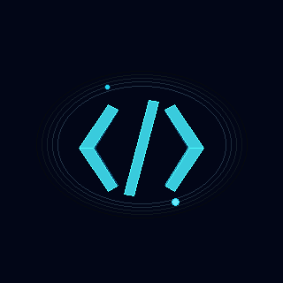

 <div align="center">

# AADVIK GEMINI

### `CS & AI/ML STUDENT` · `DEVELOPER` · `BUILDER`

**LEARN. ENGINEER. BUILD. REPEAT.**



[](https://github.com/aadvikgemini)
[](https://github.com/aadvikgemini/Aadvik-portfolio)
[](mailto:aadvikgemini@gmail.com)

</div>

---

## `01 / ABOUT ME`

I'm a Computer Science and AI/ML student at **Newton School of Technology, Rishihood University**, interested in building technology that solves real problems.

I enjoy working across software engineering, artificial intelligence and cybersecurity, while continuously improving my engineering fundamentals.

- Currently building student-focused software products.
- Exploring backend development and system design.
- Learning more about AI/ML and cybersecurity.
- Interested in open source, hackathons and entrepreneurship.

---

## `02 / DEVELOPER TERMINAL`

```bash
aadvik@engineering:~$ whoami

Name       : Aadvik Gemini
Role       : CS & AI/ML Student
University : Newton School of Technology
Interests  : Software Engineering
             Artificial Intelligence
             Cybersecurity
             Entrepreneurship
Status     : Learning & Building

aadvik@engineering:~$ echo "Let's build something meaningful."
```

---

## `03 / SELECTED PROJECTS`

<table>
<tr>
<td width="50%" valign="top">

### ScratchNotes

A student-focused academic resource platform designed to make learning materials easier to organise, discover and share.

**Stack:** Python · FastAPI · SQLite

[](https://github.com/aadvikgemini/ScratchNotes)

</td>
<td width="50%" valign="top">

### Personal Portfolio

A personal website showcasing my developer identity, projects and learning journey.

**Stack:** React · TypeScript · Tailwind CSS

[](https://github.com/aadvikgemini/Aadvik-portfolio)

</td>
</tr>
</table>

---

## `04 / ENGINEERING ARSENAL`

**Languages**


**Frontend**


**Backend & Tools**


---

## `05 / GITHUB ANALYTICS`

<div align="center">


<br/>


</div>

---

## `06 / CONTRIBUTION ACTIVITY`

<div align="center">


</div>

---

## `07 / CURRENT FOCUS`

```text
[01] Strengthening programming fundamentals
[02] Building practical software projects
[03] Exploring backend engineering
[04] Learning AI/ML and cybersecurity
[05] Preparing for open-source contributions
```

---

## `08 / CONNECT WITH ME`

<div align="center">

[](https://github.com/aadvikgemini)
[](https://instagram.com/a_a_d_v_i_k8913)
[](mailto:aadvikgemini@gmail.com)

<br/>

### `ENGINEER YOUR IDEAS. BUILD YOUR FUTURE.`


</div>
