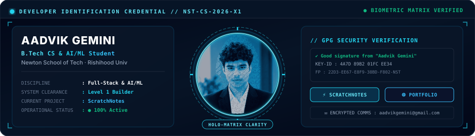
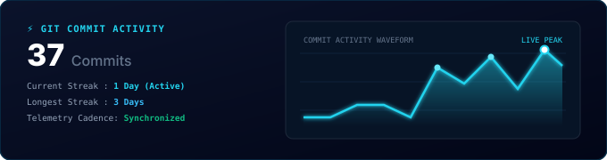
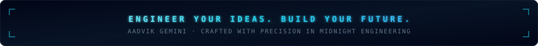

<div align="center">

<!-- Hero Banner Header -->


<br/><br/>

<!-- Holographic Developer ID Credential Badge -->


<br/>

<!-- Quick Navigation & Identity Badges -->
<a href="https://github.com/aadvikgemini">
  
</a>
&nbsp;
<a href="https://github.com/aadvikgemini/Aadvik-portfolio">
  
</a>
&nbsp;
<a href="mailto:aadvikgemini@gmail.com">
  
</a>
&nbsp;
<a href="https://instagram.com/a_a_d_v_i_k8913">
  
</a>

<br/><br/>


</div>

## `01 / ABOUT ME`

I am a Computer Science and AI/ML student at **Newton School of Technology, Rishihood University**, focused on building practical, high-performance software and mastering engineering fundamentals.

I explore full-stack architecture, backend systems, machine learning, and cybersecurity — transforming theoretical concepts into resilient, production-ready code.

- 🛠️ **Engineering Focus:** Robust backend design, API integration, and full-stack software development.
- 🔬 **Continuous Learning:** Exploring deep learning architectures, cryptographic security, and systems programming.
- 🚀 **Builder Mindset:** Active hackathon participant, open-source contributor, and aspiring technology founder.
- 🎯 **Long-Term Objective:** Crafting scalable software solutions that solve real-world human problems.

<div align="center">
  
</div>

## `02 / DEVELOPER TERMINAL`

<div align="center">
  
</div>

<div align="center">
  
</div>

## `03 / FEATURED PROJECTS`

<table>
<tr>
<td width="50%" valign="top">

### 📘 [ScratchNotes](https://github.com/aadvikgemini/ScratchNotes)
> *Academic resource-sharing platform engineered for seamless student collaboration.*

- **Architecture:** High-performance RESTful API backend built with FastAPI & SQLAlchemy 2.x.
- **Security:** Argon2id cryptographic password hashing, stateless HS256 JWT authentication, and sliding-window IP rate limiting.
- **File Pipeline:** Streamed multipart upload engine with UUID keys and binary download stream tracking.

<br/>

```text
Stack : Python · FastAPI · SQLite · Pydantic · JWT
```

<a href="https://github.com/aadvikgemini/ScratchNotes">
  
</a>

</td>
<td width="50%" valign="top">

### 🌐 [Personal Portfolio](https://github.com/aadvikgemini/Aadvik-portfolio)
> *Interactive personal developer portfolio showcasing engineering projects and identity.*

- **Frontend Core:** Built with React 18 and strict TypeScript for robust type safety.
- **User Interface:** Styled using Tailwind CSS with custom responsive layouts and fluid interactions.
- **Build Tooling:** Bundled with Vite for instant hot-module replacement and optimized static assets.

<br/>

```text
Stack : React · TypeScript · Tailwind CSS · Vite
```

<a href="https://github.com/aadvikgemini/Aadvik-portfolio">
  
</a>

</td>
</tr>
</table>

<div align="center">
  
</div>

## `04 / ENGINEERING ARSENAL`

<div align="center">

#### Core Languages & Foundation

&nbsp;

&nbsp;

&nbsp;


<br/>

#### Frontend Development

&nbsp;

&nbsp;


<br/>

#### Backend, Storage & Tooling

&nbsp;

&nbsp;

&nbsp;


</div>

<div align="center">
  
</div>

## `05 / TELEMETRY & GITHUB METRICS`

<div align="center">


&nbsp;


<br/><br/>



</div>

<div align="center">
  
</div>

## `06 / CURRENT ENGINEERING SPRINT`

```text
[01] Deepening Data Structures & Algorithms problem-solving discipline
[02] Expanding ScratchNotes platform architecture & documentation
[03] Engineering secure RESTful APIs with strict validation & rate limiting
[04] Exploring Machine Learning foundations & cryptographic security
[05] Preparing collaborative open-source contributions for developer tooling
```

<div align="center">
  
</div>

## `07 / CONNECT & COLLABORATE`

<div align="center">

<a href="https://github.com/aadvikgemini">
  
</a>
&nbsp;
<a href="https://instagram.com/a_a_d_v_i_k8913">
  
</a>
&nbsp;
<a href="mailto:aadvikgemini@gmail.com">
  
</a>

<br/><br/>

<!-- Custom Cybernetic Footer Banner -->


</div>
